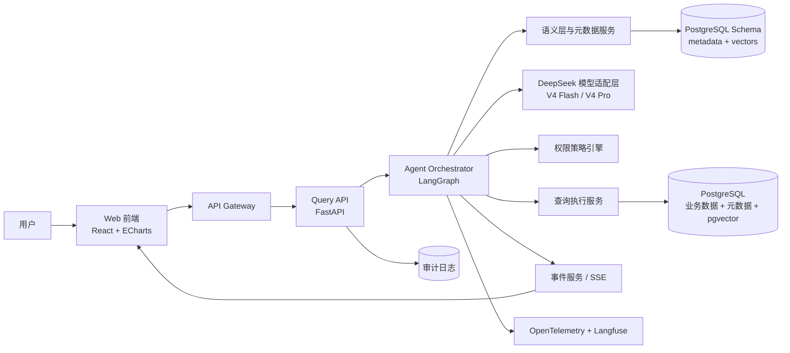
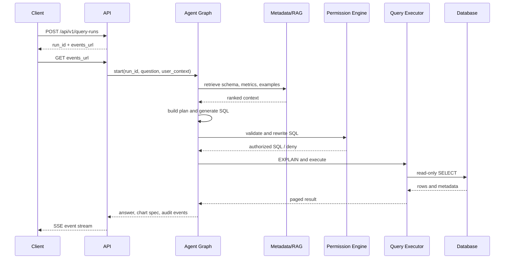
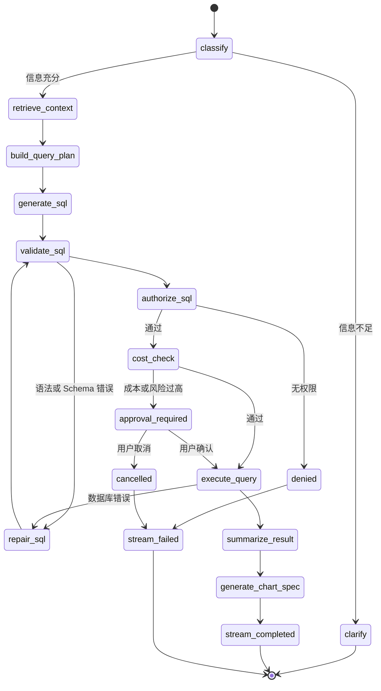
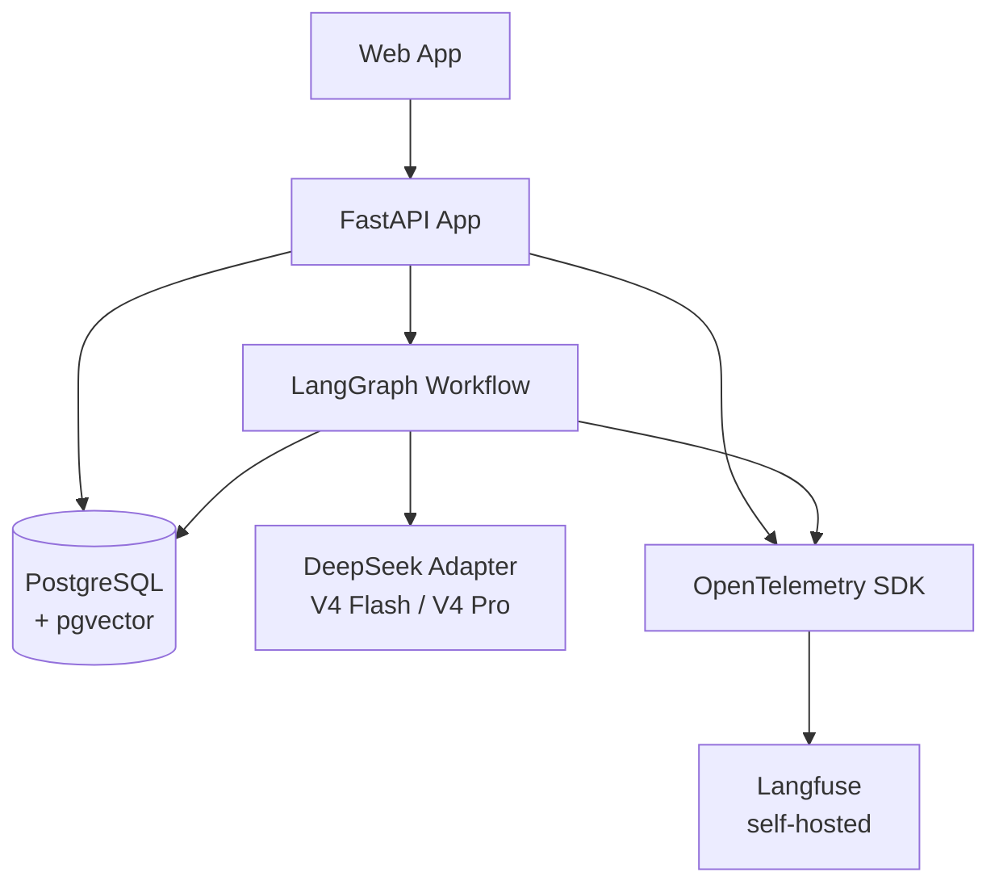

# Intelligent Data Agent 架构设计

> 面向 BI 分析的自然语言数据查询与实时可视化平台设计。
>
> 文档状态：架构蓝图 / MVP 设计
>
> 适用范围：单个 PostgreSQL 实例（含 pgvector），DeepSeek V4 Flash/Pro 模型接入，基础角色与行列权限，SSE 实时事件流。

## 1. 项目目标与首期范围

### 1.1 项目目标

系统允许用户用自然语言查询结构化数据，并返回：

- 可解释的查询意图和指标定义；
- 经过权限校验的 SQL；
- 表格、聚合结果和自然语言结论；
- 可被前端安全渲染的图表配置；
- 可追踪、可审计的完整执行过程。

模型负责理解、规划和生成候选结果，权限、SQL 校验、执行、分页、审计和图表协议由确定性后端代码控制。

### 1.2 首期范围

| 项目 | 首期决定 |
| --- | --- |
| 产品场景 | BI 分析、指标问答、明细查询和图表生成 |
| 数据源 | PostgreSQL（平台元数据和业务分析数据共用一个实例） |
| 模型 | DeepSeek V4 Flash + DeepSeek V4 Pro，通过固定的 DeepSeek 适配层接入 |
| 权限 | 单租户、基础角色、数据集权限、行级过滤和列级脱敏 |
| 交互协议 | HTTP API + SSE 单向事件流 |
| 写操作 | 禁止 Agent 修改业务数据，仅允许受控查询 |
| 前端图表 | React + TypeScript + ECharts |

### 1.3 非首期范围

- 自然语言修改、删除或写入业务数据；
- 多数据库和跨库联邦查询；
- 通用文档问答和企业流程自动化；
- 完全自由循环的多 Agent 自主决策；
- 以模型输出的 JavaScript 直接执行图表。

## 2. 总体系统架构

### 2.1 逻辑架构



### 2.2 服务边界

| 服务 | 主要职责 |
| --- | --- |
| API Gateway | 认证、限流、请求路由、SSE 入口 |
| Query API | 创建查询任务、读取历史、取消和确认任务 |
| Agent Orchestrator | 编排意图识别、检索、SQL 生成、验证和结果总结 |
| Metadata Module | 管理 PostgreSQL 表字段、指标、术语和 SQL 示例 |
| Permission Service | 计算用户可访问的数据集、行过滤和列脱敏规则 |
| Query Service | 只读连接、SQL AST 检查、成本检查、分页和超时 |
| DeepSeek Model Adapter | 统一调用 V4 Flash/Pro、超时、重试、Token 与成本统计 |
| Event Service | 统一事件模型、SSE 推送、断线恢复 |
| Audit Service | 记录用户、模型、SQL、权限决策和执行结果摘要 |

MVP 直接使用一个 FastAPI 应用和一个 PostgreSQL 实例，内部按模块组织代码，不引入独立微服务。
业务数据、平台元数据、向量和审计记录均在同一 PostgreSQL 实例中，通过不同 Schema 或数据库角色区分。

### 2.3 查询数据流



## 3. 大模型核心技术

### 3.1 Text-to-SQL

Text-to-SQL 不应采用“完整 DDL + 一次生成 SQL”的单步模式，建议拆分为：

1. 识别业务主题、时间范围、指标、维度和排序要求；
2. 从语义层检索相关指标、表、字段、关联关系和 SQL 示例；
3. 生成结构化查询计划；
4. 按 PostgreSQL 语法生成 SQL；
5. 解析 SQL AST，并限制为安全查询；
6. 注入租户和行级权限条件；
7. 执行 `EXPLAIN` 和成本检查；
8. 在可控次数内根据数据库错误修复 SQL；
9. 执行查询并总结结果。

涉及的核心技术：

- Schema linking：将自然语言实体映射到表、字段和指标；
- Few-shot SQL retrieval：检索相似问题和经过确认的 SQL；
- Structured Output：使用 JSON Schema 约束计划和图表配置；
- Function Calling：将数据库查询、元数据查询和解释操作暴露为工具；
- PostgreSQL SQL 生成：统一使用 PostgreSQL 语法，减少方言分支和测试成本；
- Query cost estimation：根据 `EXPLAIN`、扫描行数和超时策略控制风险；
- Result synthesis：将结果转换为可验证的自然语言结论。

### 3.2 语义层与指标层

模型不应只依赖数据库字段名称。建议建立独立的业务语义层：

```yaml
metric:
  name: monthly_revenue
  display_name: 月销售额
  expression: SUM(order_items.amount)
  dimensions: [order_date, region, product_category]
  filters: [order_status = 'paid']
  owner: finance
  sensitivity: internal
```

语义层至少维护：

- 指标定义、计算表达式和默认过滤条件；
- 维度、时间粒度和允许的聚合方式；
- 表、字段别名、描述和枚举值；
- 表之间的关联关系和主外键；
- 常用 SQL 示例和已确认问答；
- 数据更新时间、负责人和质量说明；
- 敏感字段标签、脱敏策略和访问范围。

### 3.3 RAG 内容

首期使用同一个 PostgreSQL 实例和 `pgvector` 扩展保存平台元数据、业务分析数据、向量和审计记录，避免引入第二套 SQL 数据库。检索内容包括：

- DDL、字段注释和数据样例摘要；
- 指标和业务术语；
- SQL 示例；
- 历史查询中被用户确认的结果；
- 数据质量和更新时间说明；
- 权限策略的可读描述。

敏感数据不应直接写入向量库。生产环境必须对索引内容进行租户隔离和敏感字段过滤。

### 3.4 DeepSeek 模型分层

系统只接入 DeepSeek，使用两个固定模型版本：

| 模型 | 主要职责 | 典型节点 |
| --- | --- | --- |
| DeepSeek V4 Flash | 低延迟、低成本的轻量任务 | 意图识别、查询补充信息判断、上下文筛选、简单查询计划、事件文案 |
| DeepSeek V4 Pro | 复杂推理和高准确率任务 | 复杂查询计划、SQL 生成、SQL 修复、权限语义解释、结果总结和 ChartSpec 生成 |

Agent 在 `classify` 和 `build_query_plan` 阶段先使用 Flash 判断问题复杂度；简单查询可以继续使用 Flash，涉及多表关联、复杂指标、嵌套查询或 SQL 修复时切换到 Pro。该切换只发生在 DeepSeek 的两个模型版本之间，不引入其他模型供应商或多供应商故障转移。

后端实现一个固定的 `DeepSeekModelAdapter`，统一封装：

- Flash/Pro 的模型标识和调用参数；
- 请求超时、有限次数重试和取消；
- Token、延迟和成本统计；
- Prompt 版本和模型版本记录；
- 结构化输出和 JSON Schema 校验。

适配层不负责业务权限、SQL 执行或结果裁剪，这些逻辑仍由确定性的后端服务控制。

## 4. Text-to-SQL 与语义层设计

### 4.1 查询计划

模型先输出查询计划，后端验证计划后再允许生成 SQL：

```json
{
  "subject": "sales",
  "metrics": ["monthly_revenue"],
  "dimensions": ["month", "region"],
  "time_range": {
    "field": "order_date",
    "start": "2026-01-01",
    "end": "2026-12-31"
  },
  "filters": [],
  "sort": [{"field": "month", "direction": "asc"}],
  "limit": 1000
}
```

### 4.2 SQL 安全策略

- 只允许单条 `SELECT` 或受控 `WITH ... SELECT`；
- 使用 SQLGlot 等 SQL AST 解析器，不依赖字符串黑名单；
- 禁止 `INSERT`、`UPDATE`、`DELETE`、`DROP`、`ALTER`、`TRUNCATE`、存储过程和多语句；
- 强制最大返回行数、超时、分页和最大扫描成本；
- 查询使用只读数据库账号；
- 执行前做权限检查和 `EXPLAIN`；
- 后端追加租户过滤条件，模型不能覆盖或删除该条件；
- 对敏感列执行脱敏、聚合或拒绝返回；
- 失败修复最多 1 至 2 次，超过次数转为明确错误。

### 4.3 查询正确性策略

分离以下几类错误，便于定位和评估：

| 错误类型 | 示例 | 处理方式 |
| --- | --- | --- |
| 语法错误 | 字段拼写、PostgreSQL 语法错误 | 将数据库错误反馈给 SQL 修复节点 |
| Schema 错误 | 表或字段不存在 | 重新检索元数据并重新生成 |
| 业务语义错误 | 把订单数当销售额 | 回到指标层确认定义 |
| 权限错误 | 访问未授权列 | 拒绝或使用脱敏列 |
| 成本错误 | 全表扫描、结果过大 | 要求缩小范围或降低粒度 |

## 5. LangGraph Agent 工作流和状态机

本方案已确定使用 LangGraph 作为唯一 Agent 编排框架。查询流程采用显式状态图实现，使用其持久化、流式执行、人工介入和断点恢复能力；业务权限、SQL 校验和数据库执行仍由自有确定性节点负责。

### 5.1 LangGraph 状态图



### 5.2 Agent 状态

```python
class QueryRunState(TypedDict):
    run_id: str
    user_id: str
    question: str
    intent: dict | None
    retrieved_context: list[dict]
    query_plan: dict | None
    candidate_sql: str | None
    authorized_sql: str | None
    result_schema: list[dict]
    result_preview: list[dict]
    chart_spec: dict | None
    retry_count: int
    status: str
    error: dict | None
```

生产环境使用 PostgreSQL Checkpointer 保存可恢复状态；长任务、人工确认和断线重连都以 `run_id` 为关联键。

## 6. 前后端技术栈

### 6.1 前端

- React 19；
- TypeScript；
- Next.js；
- Ant Design 5；
- TanStack Query；
- Zustand；
- Apache ECharts；
- Monaco Editor；
- 原生 `EventSource` 或兼容 SSE 的客户端封装。

#### 6.1.1 桌面端布局

采用“左侧历史导航 + 中间查询工作区 + 右侧详情面板”的三栏布局，默认适配 1440px 以上屏幕：

```text
┌─────────────────────────────────────────────────────────────────────────────┐
│ 顶部栏：产品名称 | 新建查询 | 查询历史 | 指标说明                 用户菜单 │
├───────────────┬───────────────────────────────────────┬─────────────────────┤
│ 左侧导航       │ 中间查询工作区                         │ 右侧详情面板         │
│ 240px          │ minmax(560px, 1fr)                   │ 360px               │
│               │                                       │                     │
│ + 新建查询     │ 对话/问题区                            │ 查询状态             │
│ 最近查询       │ ┌─────────────────────────────────┐ │ - 当前阶段           │
│  - 查询标题    │ │ 用户问题                         │ │ - 执行耗时           │
│  - 时间        │ └─────────────────────────────────┘ │ - 返回行数           │
│ 收藏查询       │                                       │                     │
│                 │ Agent 过程时间线                      │ SQL 查看             │
│                 │ [理解问题] [检索指标] [生成 SQL]      │ Monaco Editor        │
│                 │ [校验] [执行] [生成图表]              │ 只读、可复制         │
│                 │                                       │                     │
│                 │ 结果区                                │ 查询说明             │
│                 │ [概览] [图表] [数据表] [SQL]          │ 指标、字段、时间范围 │
│                 │ KPI 卡片                              │ 数据更新时间         │
│                 │ ECharts 图表 / 分页表格               │                     │
│                 │                                       │ [重新查询] [反馈]    │
│                 │ 底部输入框：自然语言问题       [发送] │                     │
└───────────────┴───────────────────────────────────────┴─────────────────────┘
```

布局约束：

- 顶部栏高度固定为 56px；
- 左侧导航宽度固定为 240px，可折叠为 64px 图标栏；
- 右侧详情面板宽度固定为 360px，可关闭；
- 中间工作区最小宽度为 560px，图表和表格在其中自适应；
- 查询输入框固定在中间区域底部，滚动结果时保持可见；
- 结果区使用 `概览 / 图表 / 数据表 / SQL` Tabs，避免同时堆叠多个大面板；
- SQL 默认只读，只有明确点击“复制 SQL”才复制到剪贴板。

#### 6.1.2 页面区域职责

| 区域 | 组件 | 职责 |
| --- | --- | --- |
| 顶部栏 | `AppHeader` | 新建查询、导航、当前用户和连接状态 |
| 左侧栏 | `QueryHistorySidebar` | 查询历史、收藏、重命名和删除 |
| 问题区 | `QueryComposer` | 输入问题、发送、取消、重试和显示快捷问题 |
| 时间线 | `AgentTimeline` | 展示 SSE 阶段事件、耗时和错误 |
| 概览 | `InsightSummary` | 自然语言结论、关键指标和数据更新时间 |
| 图表 | `ChartPanel` | 根据 ChartSpec 渲染 ECharts，支持下载图片 |
| 数据表 | `DataTable` | 分页、列排序、列筛选和导出小结果集 |
| SQL | `SqlViewer` | Monaco 只读查看、复制和显示权限改写标记 |
| 详情 | `QueryInspector` | 查询状态、指标定义、字段来源和执行信息 |
| 反馈 | `FeedbackActions` | 正确、有帮助、结果不正确和文字反馈 |

#### 6.1.3 查询状态和交互

前端根据 SSE 事件维护一个 `QueryRunViewModel`，状态变化如下：

```text
idle
  → submitting
  → streaming
      ├─ awaiting_clarification 需要补充条件
      ├─ awaiting_approval 高成本查询确认
      ├─ showing_preview 已有部分结果
      └─ completed
  → failed / cancelled
```

- `submitting`：发送按钮进入 loading，输入框仍可编辑；
- `streaming`：时间线逐步显示 Agent 阶段，图表区域显示骨架屏；
- `awaiting_clarification`：在输入框上方显示需要补充的问题，不生成错误图表；
- `awaiting_approval`：显示扫描成本、预计行数和“确认执行”按钮；
- `completed`：按 ChartSpec 渲染图表，同时填充表格和 SQL 面板；
- `failed`：保留已生成的 SQL 和错误阶段，提供“重试”按钮；
- `cancelled`：保留已收到的事件和结果预览，不允许继续追加事件。

#### 6.1.4 移动端布局

屏幕宽度小于 768px 时切换为单栏：

1. 顶部栏只保留菜单、新建查询和用户入口；
2. 左侧历史导航改为抽屉；
3. 右侧详情面板改为底部抽屉，通过“查看详情”打开；
4. 图表和表格占满内容宽度，表格支持横向滚动；
5. 查询输入框固定在底部安全区域上方；
6. SQL、指标说明和执行信息默认折叠，避免遮挡结果。

#### 6.1.5 推荐前端目录

```text
src/
├── app/                         # Next.js 路由和全局布局
├── components/
│   ├── layout/                  # AppHeader、Sidebar、ResponsiveShell
│   ├── query/                   # QueryComposer、AgentTimeline、QueryInspector
│   ├── result/                  # InsightSummary、ChartPanel、DataTable、SqlViewer
│   └── feedback/                # FeedbackActions
├── features/query-run/
│   ├── api.ts                   # 创建任务、取消、确认和历史 API
│   ├── sse.ts                   # EventSource、重连和 Last-Event-ID
│   ├── store.ts                 # Zustand 查询运行状态
│   └── types.ts                 # SSE Event、ChartSpec、ResultSchema
├── lib/
│   ├── chart/                   # ChartSpec 到 ECharts option 的适配器
│   └── http/                    # API 客户端和鉴权
└── styles/
```

前端只消费后端返回的 `ChartSpec`、结果 Schema 和 SSE 事件，不让模型输出的 JavaScript 进入浏览器执行。

### 6.2 后端

- Python 3.12；
- FastAPI；
- LangGraph；
- Pydantic v2；
- SQLAlchemy；
- SQLGlot；
- asyncpg；
- PostgreSQL + pgvector；
- FastAPI BackgroundTasks；
- OpenTelemetry；
- Langfuse（自托管或本地运行）。

### 6.3 基础设施

- Docker Compose：本地免费运行 PostgreSQL、应用和 Langfuse；
- PostgreSQL：业务分析数据、平台元数据、Agent 状态、向量和审计记录；
- 本地文件或 PostgreSQL 临时表：小规模结果导出；
- FastAPI BackgroundTasks：执行轻量异步任务；
- OpenTelemetry SDK：采集应用和 Agent 链路；
- Langfuse：本地查看 Prompt、Trace、Token 和评测结果。

## 7. 数据库、权限和安全设计

### 7.1 权限模型

```text
User
  └── Role
       └── DatasetPolicy
            ├── allowed_tables
            ├── allowed_columns
            ├── row_filters
            └── masking_rules
```

权限判断输入：

- `user_id`；
- 用户角色；
- PostgreSQL 数据集；
- 请求的指标、维度和字段；
- 原始 SQL AST。

权限判断输出：

- 是否允许访问；
- 允许使用的表和列；
- 强制行过滤条件；
- 列脱敏或聚合规则；
- 是否需要人工确认。

### 7.2 数据库安全

- 业务查询使用 PostgreSQL 只读连接；
- 应用服务不保存明文数据库密码；
- 平台元数据和业务数据使用不同 Schema 或数据库角色隔离；
- 查询设置 statement timeout；
- 查询结果分页并限制最大行数；
- 小规模结果导出到本地文件或 PostgreSQL 临时表；
- 审计记录不保存不必要的敏感原始数据；
- 生产环境启用 TLS 和网络白名单。

### 7.3 审计字段

```json
{
  "run_id": "run_123",
  "user_id": "user_456",
  "question": "查询今年各区域每月销售额趋势",
  "model": "deepseek-v4-pro",
  "model_tier": "pro",
  "prompt_version": "sql-agent-v3",
  "candidate_sql_hash": "sha256:...",
  "authorized_sql_hash": "sha256:...",
  "permission_decision": "allow",
  "row_count": 120,
  "duration_ms": 1840,
  "status": "completed",
  "created_at": "2026-10-19T08:00:00Z"
}
```

## 8. SSE 实时事件协议

### 8.1 创建查询任务

```http
POST /api/v1/query-runs
Content-Type: application/json
Authorization: Bearer <token>
```

```json
{
  "question": "查询今年各区域每月销售额趋势",
  "conversation_id": "conv_123",
  "visualization": "auto"
}
```

响应：

```json
{
  "run_id": "run_123",
  "status": "running",
  "events_url": "/api/v1/query-runs/run_123/events"
}
```

### 8.2 事件流

```http
GET /api/v1/query-runs/run_123/events
Accept: text/event-stream
Authorization: Bearer <token>
Last-Event-ID: 12
```

事件统一格式：

```text
id: 12
event: chart_spec_ready
data: {"run_id":"run_123","type":"chart_spec_ready","data":{...}}

```

事件类型：

```text
run_started
intent_detected
context_retrieved
query_plan_created
sql_generated
sql_validated
approval_required
query_started
query_progress
result_preview
chart_spec_ready
answer_delta
run_completed
run_failed
```

服务端为每个 `run_id` 保留事件序号和短期事件缓存，客户端通过 `Last-Event-ID` 断线恢复。前端应处理重连、重复事件、取消和失败状态。

### 8.3 查询取消和确认

```http
POST /api/v1/query-runs/{run_id}/cancel
POST /api/v1/query-runs/{run_id}/approve
```

只有处于 `approval_required` 的任务允许确认，确认时必须重新检查任务状态和用户权限。

## 9. ChartSpec 设计

模型只能输出经过 Pydantic 校验的 ChartSpec，前端将其转换为固定的 ECharts option，不执行模型生成的 JavaScript。

```json
{
  "version": "1.0",
  "chart_type": "line",
  "title": "各区域月销售额趋势",
  "dataset": {
    "columns": ["month", "region", "sales_amount"],
    "rows": [
      {"month": "2026-01", "region": "华东", "sales_amount": 120000},
      {"month": "2026-01", "region": "华南", "sales_amount": 98000}
    ]
  },
  "encoding": {
    "x": {"field": "month", "type": "temporal"},
    "series": {"field": "region", "type": "nominal"},
    "y": {"field": "sales_amount", "type": "quantitative", "format": "currency"}
  },
  "interactions": {
    "tooltip": true,
    "legend": true,
    "zoom": true
  }
}
```

允许的首期图表类型：

| 类型 | 适用场景 |
| --- | --- |
| `table` | 明细、宽表和无法稳定聚合的结果 |
| `kpi` | 单指标、同比和环比 |
| `line` | 时间趋势 |
| `bar` | 类别比较 |
| `pie` | 少量类别占比 |
| `area` | 时间累计和构成 |

图表生成规则：

- 没有时间字段时不得强制生成折线图；
- 类别超过阈值时优先使用条形图或表格；
- 字段类型和单位由后端结果 Schema 提供；
- 空结果返回表格和明确提示，不生成空图；
- 图表和表格使用同一份结果快照。

## 10. 核心 API 设计

```text
POST /api/v1/query-runs
GET  /api/v1/query-runs/{id}
GET  /api/v1/query-runs/{id}/events
POST /api/v1/query-runs/{id}/approve
POST /api/v1/query-runs/{id}/cancel
GET  /api/v1/query-runs
POST /api/v1/feedback
GET  /api/v1/metrics
GET  /api/v1/audit-logs
```

查询完成事件示例：

```json
{
  "type": "run_completed",
  "run_id": "run_123",
  "data": {
    "status": "completed",
    "authorized_sql": "SELECT ...",
    "row_count": 120,
    "result_url": "/api/v1/query-runs/run_123/result",
    "chart_event_id": "18",
    "answer": "今年华东区域销售额最高，第四季度呈上升趋势。"
  }
}
```

建议不在 SSE 完成事件中传输超大结果集。结果超过阈值时，将结果保存到 PostgreSQL 临时表或本地文件，事件只返回分页 API 或本地下载地址。

## 11. 部署和可观测性

### 11.1 部署拓扑



### 11.2 必备指标

- 请求量、并发查询数和后台任务数量；
- 首个事件延迟、首个结果延迟和总耗时；
- SQL 生成成功率和执行成功率；
- SQL 修复次数和权限拒绝次数；
- 结果正确率和用户反馈；
- Token 用量和单次成本；
- 查询超时、取消和 PostgreSQL 错误；
- SSE 断线率和重连成功率；
- Flash 与 Pro 的质量、延迟、Token 用量和成本。

### 11.3 日志和追踪

所有模块使用同一个 `trace_id` 和 `run_id`。OpenTelemetry 负责记录 API、LangGraph 节点、DeepSeek 调用和 PostgreSQL 查询的运行链路；Langfuse 负责 Prompt、模型响应、Token、成本、用户反馈和 Agent 评测。两者均采用本地或自托管方式运行。模型输入和输出应默认做敏感信息过滤，记录摘要、哈希和版本；只有经过授权的调试环境才允许保留完整 Prompt。

## 12. MVP 分阶段实施计划

### 阶段一：基础闭环

- 一个 PostgreSQL 数据源；
- 单租户和基础用户认证；
- 自然语言生成只读 SELECT；
- SQL AST 校验和只读执行；
- SSE 查询过程；
- 表格、KPI 和折线图；
- 查询历史和基础审计；
- 一次 SQL 自动修复。

验收：常见问题可生成并执行正确 SQL，禁止写操作，前端可实时展示状态和结果。

### 阶段二：基础权限

- 用户和角色；
- PostgreSQL 数据集权限、行级过滤和列脱敏；
- 查询成本限制和高风险确认；
- 审计日志完善；
- PostgreSQL 只读角色。

验收：越权问题无法绕过权限，审计日志可以还原一次查询，所有生成 SQL 都经过授权改写。

### 阶段三：语义层和质量提升

- 指标中心；
- SQL 示例库；
- Schema RAG；
- 业务术语词典；
- 用户反馈闭环；
- 离线评测集；
- Prompt 和模型版本管理。

### 阶段四：生产化和扩展

- Flash/Pro 复杂度路由和模型版本管理；
- OpenTelemetry 和 Langfuse 评测；
- 基础限流和查询缓存；
- 中小结果集导出；
- 多 Agent 数据质量和解释能力。

### 后续执行阶段 6-9：评测强化与语义检索

#### 阶段 6：Demo 数据扩充

- 将区域、商品和时间跨度扩展到真实量级；
- 构造具有季节性和区域差异的订单分布；
- 支持 `DEMO_SCALE` 与 `DEMO_YEARS` 控制数据规模；
- 为常用过滤、关联和聚合列补齐索引。

验收：重复初始化幂等；简单、聚合、复杂查询在大数据量下稳定执行；`EXPLAIN` 成本可真实反映查询规模。

#### 阶段 7：黄金问题集和评测口径扩充

- 将黄金问题扩展到 30 条左右，覆盖过滤、关联、同比环比、空结果、歧义、权限等场景；
- 为每条问题补充预期指标、SQL 语义、结果不变量和图表；
- 评测支持精确集合、非空、空结果和不变量四类结果口径；
- 支持按类别和指标输出两级准确率汇总。

验收：golden SQL 可先自校验；评测集可重复执行并输出稳定基线。

#### 阶段 8：本地轻量 embedding 与 pgvector

- 从 ModelScope 或 Hugging Face 部署体积较小的本地多语言 embedding 模型；
- 新增 `metadata.embeddings` 表，保存表、字段和指标定义的向量；
- 提供幂等的 metadata 重建脚本；
- 保留无模型环境下的确定性降级实现。

验收：向量化脚本可重复运行；同一模型版本下向量稳定。

#### 阶段 9：metadata 混合语义检索

- 用向量相似度为主、关键词得分为辅的混合检索替换关键词检索；
- 支持同义词和口语化表达命中标准指标；
- 输出检索来源用于可解释性和评测；
- 使用阶段 7 的评测集对比接入前后的准确率。

验收：SQL Semantic Accuracy 与复杂问题 Result Accuracy 有可测量提升，且无评测回退。

### 后续执行阶段 10-13：语义层、评测闭环与产品增强

#### 阶段 10：语义层与标准指标映射

- 新增 `backend/app/semantic/`，定义指标字典、维度字典和标准 SQL 模板；
- 新增 `SemanticMetric`、`SemanticDimension`、`SemanticMapping` 模型及迁移；
- 建立指标别名、公式、口径、默认粒度、默认图表类型和可访问维度；
- 在工作流中新增 `semantic_map` 节点，把问题映射为标准指标和维度；
- 将语义映射结果注入 SQL 生成 Prompt，减少模型自由发挥；
- 使用阶段 7 评测集对比语义层接入前后的准确率。

验收：指标口径一致，复杂问题 Result Accuracy 提升，评测无回退。

#### 阶段 11：持续评测闭环

- 新增 GitHub Actions 评测流水线，PR 变更时自动运行测试与评测；
- 增加 `--threshold` 选项，准确率低于基线时使流水线失败；
- 增加离线 `--golden-only` 或 `--self-check` 模式用于快速门禁；
- 新增反馈候选导入脚本，把「结果错误」反馈沉淀为候选黄金问题；
- 评测报告作为流水线产物归档。

验收：每次 Prompt、metadata 或授权改动都能自动得到准确率变化，回退可阻断合并。

#### 阶段 12：结果缓存与失效策略

- 为 QueryRun 增加缓存键、数据版本和过期时间；
- 新增 `cache_service`，按标准化问题、数据版本和语义版本生成缓存键；
- 增加 `QUERY_CACHE_TTL_SECONDS` 配置，默认启用有限 TTL；
- 记录 Demo 数据更新时间，数据重建后自动失效；
- 提供手动「重新计算」能力，用户可强制刷新缓存结果。

验收：重复问题可命中缓存，数据版本或 TTL 变化后能正确失效并重算。

#### 阶段 13：多轮对话与追问

- 新增 Conversation 模型，为 QueryRun 增加 `conversation_id` 和 `turn_index`；
- 请求与响应契约支持传递和回显 `conversation_id`；
- 工作流把上一轮语义、表字段和筛选条件注入当前轮；
- 前端保持会话上下文，支持「只看华东」「按月份看」等追问；
- 增加多轮对话的 API 测试与 Playwright 流程。

验收：同一会话内可连续追问，上下文正确，跨会话隔离。

## 13. 测试与评估指标

### 13.1 功能和安全测试

- SQL 只读校验；
- 多语句、注入和危险函数；
- 单租户下的角色和数据集隔离；
- 行级权限注入；
- 敏感列脱敏；
- PostgreSQL SQL 语法和类型处理；
- 空结果、`NULL` 和重复数据；
- 大数据量分页和导出；
- SSE 断线重连和重复事件；
- Agent 节点失败恢复；
- 查询取消和高成本确认；
- 非法 JSON 和图表字段缺失；
- 数据库超时和并发限流。

### 13.2 离线黄金集

每条黄金问题记录：

```text
自然语言问题
预期指标
允许使用的表
期望 SQL 语义
预期结果
预期图表类型
权限场景
```

### 13.3 评估指标

| 指标 | 说明 |
| --- | --- |
| Execution Accuracy | SQL 是否成功执行并返回可接受结果 |
| Result Accuracy | 结果是否符合业务预期 |
| Metric Accuracy | 是否使用正确指标定义 |
| Permission Accuracy | 越权是否被正确拦截 |
| Chart Accuracy | 图表类型和字段映射是否合理 |
| First Event Latency | 用户看到首个状态的时间 |
| End-to-End Latency | 从提交到完成的时间 |
| Cost per Run | 单次查询模型和基础设施成本 |
| Feedback Rate | 用户确认、修正和拒绝比例 |

## 14. 最终技术选型结论

```text
Frontend:
  React + TypeScript + Next.js + ECharts + SSE

Backend:
  Python + FastAPI + LangGraph + SQLAlchemy + SQLGlot

Data:
  PostgreSQL + pgvector

LLM:
  DeepSeek V4 Flash + DeepSeek V4 Pro through DeepSeekModelAdapter

Security:
  Read-only DB roles + AST validation + row/column policy engine

Observability:
  OpenTelemetry + Langfuse

Deployment:
  Docker Compose for local and small-scale deployment
```

推荐的首期组合是 **FastAPI + LangGraph + SQLAlchemy + SQLGlot + asyncpg + PostgreSQL/pgvector + React/ECharts + SSE + DeepSeek V4 Flash/Pro + OpenTelemetry + Langfuse**。Agent 编排框架确定使用 LangGraph；模型只接入 DeepSeek 的 Flash 和 Pro 两个版本，业务代码通过 `DeepSeekModelAdapter` 调用。系统只依赖一个 PostgreSQL 实例，使用 Docker Compose 即可免费本地运行。

LangGraph 的状态图、持久化、流式执行和人工介入能力支撑本项目的查询工作流。官方文档：[LangGraph Reference](https://langchain-ai.github.io/langgraph/reference/)。
