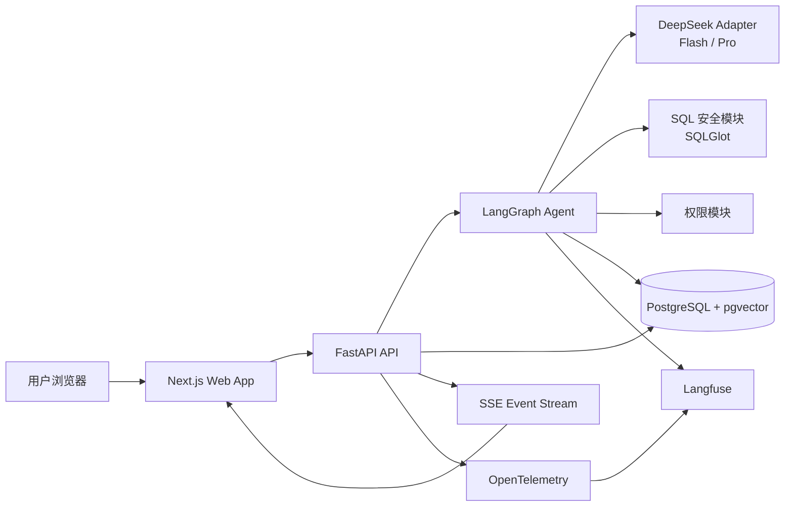

# 智能数据分析 Agent 开发落地架构

> 本文档是 `intelligent-data-agent-architecture.md` 的开发执行版，供后续分阶段实现使用。
>
> 当前状态：阶段 0 到阶段 4 已完成。前端已通过 OIDC PKCE 登录真实 FastAPI API，并完成查询创建、SSE 事件、断线续传、SQL/结果/ChartSpec、审批、取消、重试、反馈和异常状态联调。前端单元测试、类型检查、构建以及后端全量测试通过；Playwright 覆盖成功、审批、取消、重连、权限失败和空结果流程。

## 1. 开发目标与技术边界

系统目标是让用户通过自然语言查询 PostgreSQL 中的结构化数据，实时看到 Agent 执行过程、SQL、表格、图表和结论。

| 领域            | 选择                                                |
| --------------- | --------------------------------------------------- |
| 前端            | Next.js、React、TypeScript、Ant Design 5、ECharts   |
| 前端状态        | Zustand、TanStack Query                             |
| 后端            | Python、FastAPI、LangGraph                          |
| 数据访问        | SQLAlchemy、asyncpg、Alembic                        |
| SQL 安全        | SQLGlot                                             |
| 数据库          | 单个 PostgreSQL 实例 + pgvector                     |
| 大模型          | DeepSeek V4 Flash、DeepSeek V4 Pro                  |
| 实时协议        | HTTP API + SSE                                      |
| 运行观测        | OpenTelemetry + Langfuse                            |
| 本地部署        | Docker Compose                                      |
| Python 依赖管理 | `backend/pyproject.toml`，不创建 `requirements.txt` |

首期不实现多数据库、Redis、Celery、Kubernetes、业务写操作、复杂多 Agent 和商业云部署。

## 2. 总体运行架构



### 2.1 运行原则

- 首期采用单体模块化架构，前后端分别独立启动；
- 前端先使用 Mock 数据和模拟 SSE，不等待后端完成；
- 后端接口必须遵循前端阶段冻结的数据契约；
- Agent 只生成候选计划和 SQL，权限、SQL 校验和执行由后端确定性代码控制；
- PostgreSQL 同时保存 Demo 业务数据、平台元数据、Agent 状态和审计数据；
- 图表只接受后端校验后的 `ChartSpec`，浏览器不执行模型生成的 JavaScript。

## 3. 项目目录结构

```text
intelligent-data-agent/
├── backend/
│   ├── app/
│   │   ├── main.py                         # FastAPI 入口
│   │   ├── api/v1/
│   │   │   ├── query_runs.py               # 查询任务和 SSE
│   │   │   ├── metrics.py                  # 指标接口
│   │   │   ├── feedback.py                 # 用户反馈
│   │   │   └── audit.py                    # 审计查询
│   │   ├── core/
│   │   │   ├── config.py                   # Pydantic Settings
│   │   │   ├── security.py                 # 当前用户和角色
│   │   │   ├── errors.py                   # 统一异常
│   │   │   └── logging.py                  # 日志配置
│   │   ├── db/
│   │   │   ├── session.py                  # SQLAlchemy/asyncpg
│   │   │   ├── models.py                   # ORM 模型
│   │   │   └── migrations/                 # Alembic 迁移
│   │   ├── schemas/
│   │   │   ├── query_run.py                # 查询请求和响应
│   │   │   ├── query_plan.py               # 查询计划
│   │   │   ├── chart_spec.py               # ChartSpec
│   │   │   ├── sse_event.py                # SSE 事件
│   │   │   └── metric.py                   # 指标定义
│   │   ├── agents/
│   │   │   ├── state.py                    # QueryRunState
│   │   │   ├── graph.py                    # LangGraph 图
│   │   │   ├── nodes/                      # Agent 节点
│   │   │   └── prompts/                    # Prompt 模板
│   │   ├── services/
│   │   │   ├── query_service.py            # 查询生命周期
│   │   │   ├── metadata_service.py         # Schema/指标检索
│   │   │   ├── permission_service.py       # 权限和脱敏
│   │   │   ├── result_service.py           # 分页和结果 Schema
│   │   │   ├── chart_service.py            # ChartSpec 校验
│   │   │   └── event_service.py            # SSE 事件
│   │   ├── llm/
│   │   │   ├── deepseek_adapter.py         # Flash/Pro 调用
│   │   │   ├── model_router.py             # 复杂度路由
│   │   │   └── structured_output.py        # JSON Schema 校验
│   │   ├── sql/
│   │   │   ├── parser.py                   # SQLGlot AST
│   │   │   ├── validator.py                # 只读校验
│   │   │   ├── rewriter.py                 # 权限条件改写
│   │   │   └── cost_checker.py             # EXPLAIN 成本
│   │   └── observability/
│   │       ├── telemetry.py                # OpenTelemetry
│   │       └── langfuse.py                 # Trace/Evaluation
│   ├── tests/unit/
│   ├── tests/integration/
│   ├── tests/evaluation/
│   ├── pyproject.toml                      # 唯一 Python 依赖文件
│   └── .env.example
├── frontend/
│   ├── src/
│   │   ├── app/                            # Next.js 路由和布局
│   │   ├── components/
│   │   │   ├── layout/                     # AppShell、Header、响应式布局
│   │   │   ├── query/                      # 输入、时间线、详情
│   │   │   ├── result/                     # 概览、图表、表格、SQL
│   │   │   └── feedback/                   # 用户反馈
│   │   ├── features/query-run/
│   │   │   ├── api.ts                      # API Client
│   │   │   ├── mock.ts                     # Mock 查询和 SSE
│   │   │   ├── sse.ts                      # SSE 解析和重连
│   │   │   ├── store.ts                    # Zustand 状态
│   │   │   └── types.ts                    # 前后端契约
│   │   ├── lib/chart/echarts-adapter.ts    # ChartSpec 适配器
│   │   └── test/
│   ├── package.json
│   ├── playwright.config.ts
│   └── .env.example
├── infra/
│   ├── docker-compose.yml
│   └── postgres/init.sql
├── scripts/
│   ├── seed_demo_data.py
│   ├── sync_metadata.py
│   └── build_eval_set.py
├── docs/
└── README.md
```

## 4. 后端模块设计

### 4.1 API 模块

负责请求校验、用户上下文、查询任务创建和 SSE 响应，不直接生成 SQL。

```text
GET  /health
POST /api/v1/query-runs
GET  /api/v1/query-runs/{run_id}
GET  /api/v1/query-runs/{run_id}/events
GET  /api/v1/query-runs/{run_id}/result
POST /api/v1/query-runs/{run_id}/approve
POST /api/v1/query-runs/{run_id}/cancel
GET  /api/v1/query-runs
GET  /api/v1/metrics
POST /api/v1/feedback
GET  /api/v1/audit-logs
```

阶段 2 的 API 负责持久化查询请求和事件、结果分页契约及用户操作。真实 SQL 生成与执行由阶段 3 Agent 接入；因此当前新建 QueryRun 处于 `submitting`，事件流在工作流终态或客户端断开前保持连接。

### 阶段 3 配置 DeepSeek

在 `backend` 目录复制 `.env.example` 为 `.env`，仅在本机填写 DeepSeek 密钥：

```dotenv
DEEPSEEK_API_KEY=在此填写新创建的DeepSeek密钥
DEEPSEEK_BASE_URL=https://api.deepseek.com
DEEPSEEK_FLASH_MODEL=deepseek-flash
DEEPSEEK_PRO_MODEL=deepseek-v4-pro
DEEPSEEK_MAX_TOKENS=4096
AGENT_ENABLED=true
OIDC_ISSUER=https://identity.example.com/realms/ida
OIDC_AUDIENCE=intelligent-data-agent-api
OIDC_JWKS_URL=https://identity.example.com/realms/ida/protocol/openid-connect/certs
```

本地开发默认使用 Compose 中的 Keycloak realm，不需要先申请外部 OIDC 服务：

```dotenv
OIDC_ISSUER=http://localhost:8080/realms/ida
OIDC_AUDIENCE=intelligent-data-agent-api
OIDC_JWKS_URL=http://localhost:8080/realms/ida/protocol/openid-connect/certs
```

这三个值分别是 token 必须声明的签发者、API 的 audience 标识和用于下载公钥的 JWKS 地址。启动 `docker compose -f infra/docker-compose.yml up -d keycloak postgres` 后，Keycloak 会导入本地 `ida` realm。开发账号为 `developer`，密码为 `ida-dev-password`；只用于绑定到 localhost 的本地开发环境，不得复用于任何共享或生产环境。执行数据库迁移和 demo 数据初始化后，在 `backend` 目录运行 `python -m scripts.provision_dev_oidc_user`，把该固定开发身份登记到 `app.users` 并授予 demo analytics 表只读权限。若后端在容器中运行，应将三个 OIDC URL 的主机改为容器网络地址，并确保 token 的 issuer 仍与 Keycloak 对外发布的 issuer 完全一致。

可用以下 PowerShell 命令从本地 Keycloak 获取 API access token；token 留在本机变量中，不要粘贴到聊天、日志或 Linear：

```powershell
$token = (Invoke-RestMethod -Method Post -Uri "http://localhost:8080/realms/ida/protocol/openid-connect/token" -ContentType "application/x-www-form-urlencoded" -Body @{ client_id = "intelligent-data-agent-web"; username = "developer"; password = "ida-dev-password"; grant_type = "password" }).access_token
Invoke-RestMethod -Method Get -Uri "http://localhost:8000/api/v1/metrics" -Headers @{ Authorization = "Bearer $token" }
```

`backend/.env` 已被 Git 忽略。不要将真实密钥写进 `.env.example`、代码、Linear、日志或提交记录。当前配置默认关闭 Agent；只有启用 Agent 且配置了密钥后，新查询才会启动工作流。DeepSeek 当前推荐的 Flash API 模型 ID 是 `deepseek-flash`，Pro API 模型 ID 是 `deepseek-v4-pro`；旧的 `deepseek-v4-flash` 仅作为兼容别名保留。模型 ID 可通过环境变量调整，以匹配 DeepSeek 账户实际开放的模型名称。JSON 模式使用 `/chat/completions`、`response_format: {"type":"json_object"}`、`stream: false` 和 `DEEPSEEK_MAX_TOKENS`。

Langfuse 可选配置 `LANGFUSE_ENABLED=true`、`LANGFUSE_PUBLIC_KEY`、`LANGFUSE_SECRET_KEY` 和 `LANGFUSE_HOST`。启用后 OpenTelemetry SDK 使用 OTLP HTTP 将 Agent、模型调用和 PostgreSQL 查询 trace 发送到 Langfuse；Prompt 和结果正文不作为 span 属性记录。

API 使用 OIDC Bearer JWT。必须配置精确的 `OIDC_ISSUER`、`OIDC_AUDIENCE` 和签名密钥端点 `OIDC_JWKS_URL`；服务验证签名、issuer、audience、过期时间和 subject。用户需由管理员预先登记到 `app.users`，并将身份提供方的 issuer 与 subject 写入 `identity_issuer`、`identity_subject`；服务不会通过 token 邮箱自动创建或关联账号。未配置身份提供方、未登记或已停用的身份均无法访问受保护 API。查询记录、结果、SSE、审批、反馈和审计日志按内部用户 ID 隔离。

升级前已存在且 `user_id` 为空的 QueryRun 不会自动归属给任何账号，仍保留在数据库中，但通过用户 API 返回为不可见。管理员只能基于可信来源明确确认所有者后再补写 `user_id`，不得仅凭 email 推断。

#### 创建查询

```http
POST /api/v1/query-runs
Content-Type: application/json

{"question":"查询今年各区域月销售额并生成趋势图"}
```

响应与前端 `QueryRun` 类型字段一致：

```json
{
  "id":"4f71a123-77c6-4cdf-85de-fce7e3281f5c",
  "question":"查询今年各区域月销售额并生成趋势图",
  "status":"submitting",
  "events":[{"id":1,"type":"submitted","timestamp":"2026-10-20T12:00:00Z","message":"已提交查询","data":null}],
  "sql":"",
  "result":null,
  "chartSpec":null,
  "insight":"",
  "error":null,
  "clarification":null,
  "approvalReason":null,
  "reconnectCount":0,
  "startedAt":"2026-10-20T12:00:00Z",
  "completedAt":null
}
```

#### SSE 事件和断点恢复

```http
GET /api/v1/query-runs/4f71a123-77c6-4cdf-85de-fce7e3281f5c/events
Last-Event-ID: 1
Accept: text/event-stream
```

```text
id: 2
event: sql_generated
data: {"id":2,"type":"sql_generated","timestamp":"2026-10-20T12:00:01Z","message":"已生成候选 SQL","data":{"sql":"SELECT ..."}}
```

`Last-Event-ID` 与 `after_id` 查询参数都会排除已确认序号的事件；事件先写入 `app.query_events` 再发送。终态后服务端发送 `stream_end` 并关闭流。

#### 查询结果分页和 ChartSpec

```http
GET /api/v1/query-runs/4f71a123-77c6-4cdf-85de-fce7e3281f5c/result?limit=100&offset=0
```

```json
{
  "rows":[{"month":"2026-01","sales":128000}],
  "schema":[{"name":"month","type":"string","label":"月份"},{"name":"sales","type":"number","label":"销售额"}],
  "total":1,
  "limit":100,
  "offset":0
}
```

```json
{"type":"line","title":"月销售额趋势","xField":"month","yField":"sales","dataset":[{"month":"2026-01","sales":128000}]}
```

阶段 2 本地启动和 Demo 初始化：

```powershell
cd backend
Copy-Item .env.example .env
python -m alembic upgrade head
python -m scripts.seed_demo_data
python -m pytest
```

### 4.2 Agent 模块

LangGraph 只负责流程编排，固定节点如下：

```text
classify
→ clarify
→ retrieve_context
→ build_query_plan
→ generate_sql
→ validate_sql
→ authorize_sql
→ cost_check
→ approval_required
→ execute_query
→ summarize_result
→ generate_chart_spec
→ completed
```

`QueryRunState` 最小字段：

```python
class QueryRunState(TypedDict):
    run_id: str
    user_id: str
    question: str
    intent: dict | None
    retrieved_context: list[dict]
    query_plan: dict | None
    candidate_sql: str | None
    authorized_sql: str | None
    result_schema: list[dict]
    result_preview: list[dict]
    chart_spec: dict | None
    retry_count: int
    status: str
    error: dict | None
```

### 4.3 DeepSeek Adapter

`DeepSeekModelAdapter` 统一处理模型调用：

- Flash 用于意图识别、复杂度判断、上下文筛选和简单查询；
- Pro 用于复杂查询计划、SQL 生成、SQL 修复、结果总结和 ChartSpec；
- 记录模型版本、Prompt 版本、Token、耗时和错误；
- 使用 Pydantic/JSON Schema 校验结构化输出；
- 只允许有限次数重试，不负责权限和 SQL 执行。

### 4.4 SQL 模块

- SQLGlot 解析 SQL AST；
- 只允许单条 `SELECT` 或受控 `WITH ... SELECT`；
- 拦截 DML、DDL、危险函数和多语句；
- 检查表、字段和权限；
- 注入行过滤和列脱敏；
- 使用 PostgreSQL `EXPLAIN` 检查成本；
- 通过 asyncpg 执行只读查询；
- 统一转换数据库异常和结果 Schema。

### 4.5 PostgreSQL Schema

同一个 PostgreSQL 实例使用不同 Schema：

```text
app:
  users, roles, permissions, query_runs, query_events, feedback

metadata:
  tables, columns, metrics, sql_examples

analytics:
  demo_orders, demo_order_items, demo_products, demo_regions

audit:
  audit_logs
```

`metadata` 中的表、字段、指标和 SQL 示例保存向量字段，使用 `pgvector` 完成相似检索。

## 5. 前端模块设计

### 5.1 桌面端布局

```text
┌──────────────────────────────────────────────────────────────┐
│ AppHeader：产品名 | 新建查询 | 历史 | 指标说明 | 用户         │
├──────────────┬───────────────────────────────┬───────────────┤
│ QueryHistory │ QueryWorkspace                │ QueryInspector│
│ Sidebar      │ - QueryComposer                │ - 状态        │
│ 240px        │ - AgentTimeline                │ - SQL         │
│              │ - InsightSummary               │ - 指标说明    │
│              │ - ChartPanel / DataTable        │ - 执行信息    │
│              │ - SqlViewer                     │ - 反馈        │
└──────────────┴───────────────────────────────┴───────────────┘
```

布局约束：

- 顶部栏 56px；
- 左侧栏 240px，可折叠为 64px；
- 右侧面板 360px，可关闭；
- 中间工作区最小宽度 560px；
- 查询输入框固定在中间区域底部；
- 结果区使用 `概览 / 图表 / 数据表 / SQL` Tabs；
- SQL 只读显示，单独提供复制按钮。

### 5.2 组件职责

| 组件                  | 职责                               |
| --------------------- | ---------------------------------- |
| `AppShell`            | 三栏布局、响应式布局和全局状态     |
| `AppHeader`           | 产品入口、新建查询、历史和用户菜单 |
| `QueryHistorySidebar` | 查询历史、收藏、重命名和删除       |
| `QueryComposer`       | 输入、发送、取消、重试和补充条件   |
| `AgentTimeline`       | 展示 SSE 阶段、耗时、错误和重连    |
| `QueryInspector`      | 状态、SQL、指标、字段和执行信息    |
| `InsightSummary`      | 自然语言结论、KPI 和更新时间       |
| `ChartPanel`          | ChartSpec 到 ECharts 的渲染        |
| `DataTable`           | 分页、排序、筛选和小结果集导出     |
| `SqlViewer`           | Monaco 只读 SQL 查看和复制         |
| `FeedbackActions`     | 正确、有帮助、结果错误和文字反馈   |

### 5.3 前端状态和 Mock

```ts
type QueryRunStatus =
  | "idle"
  | "submitting"
  | "streaming"
  | "awaiting_clarification"
  | "awaiting_approval"
  | "completed"
  | "failed"
  | "cancelled";
```

前端通过 Zustand 保存当前 `QueryRunViewModel`，通过 TanStack Query 管理历史、指标和结果 API。SSE 客户端负责事件解析、重连和 `Last-Event-ID`。

真实后端完成前，实现以下 Mock：

```text
mockQueryRun()
mockQueryEvents()
mockQueryResult()
mockChartSpec()
```

模拟事件：

```text
submitted
→ intent_detected
→ context_retrieved
→ sql_generated
→ sql_validated
→ query_started
→ result_preview
→ chart_spec_ready
→ run_completed
```

同时覆盖补充条件、高成本确认、SQL 失败、取消、断线重连、空结果和无权限字段。

## 6. 核心依赖

### 6.1 Python 依赖

依赖统一写入 `backend/pyproject.toml`，不创建 `requirements.txt`：

```text
运行依赖：
fastapi
uvicorn[standard]
pydantic
pydantic-settings
sqlalchemy
asyncpg
alembic
sqlglot
langgraph
langchain-core
httpx
pgvector
opentelemetry-sdk
opentelemetry-instrumentation-fastapi
opentelemetry-instrumentation-sqlalchemy
langfuse

开发依赖：
pytest
pytest-asyncio
ruff
mypy
```

安装和测试：

```bash
cd backend
pip install -e .
pytest
```

### 6.2 前端依赖

```text
运行依赖：
next
react
react-dom
typescript
antd
@tanstack/react-query
zustand
echarts
echarts-for-react
@monaco-editor/react
zod
eventsource-parser

开发依赖：
eslint
prettier
vitest
@testing-library/react
playwright
```

## 7. Docker Compose 和本地运行

`infra/docker-compose.yml` 首期只负责 PostgreSQL + pgvector。FastAPI、Next.js 和 Langfuse 使用本地命令启动，后续再加入完整 Compose 编排。

```bash
docker compose -f infra/docker-compose.yml up -d postgres

cd backend
pip install -e .
uvicorn app.main:app --reload --port 8000

cd frontend
npm install
Copy-Item .env.example .env.local
npm run dev
```

默认地址：

```text
Frontend: http://localhost:3000
Backend:  http://localhost:8000
OpenAPI:  http://localhost:8000/docs
Postgres: localhost:5432
```

## 8. 分阶段开发 Todo

### 阶段 0：前后端框架和测试基线

- [x] 创建 `backend/` 和 `frontend/` 目录；
- [x] 创建 FastAPI 入口和 `/health`；
- [x] 创建 `backend/pyproject.toml`；
- [x] 创建 Next.js + TypeScript 项目；
- [x] 配置 Ant Design、ECharts、Zustand 和 TanStack Query；
- [x] 配置 Ruff、Mypy、Pytest、ESLint、Vitest 和 Playwright；
- [x] 创建基础 `AppShell`；
- [x] 创建 Docker Compose 和 PostgreSQL 初始化脚本；
- [x] 验证后端启动、前端启动、测试和构建命令。

验收命令：

```bash
cd backend && pytest
cd frontend && npm run lint && npm run test && npm run build
```

### 阶段 1：前端 UI 优先开发

- [x] 实现桌面三栏布局；
- [x] 实现移动端抽屉布局；
- [x] 实现 `QueryComposer`、`AgentTimeline` 和 `QueryInspector`；
- [x] 实现 `InsightSummary`、`ChartPanel`、`DataTable` 和 `SqlViewer`；
- [x] 实现查询历史侧栏和反馈组件；
- [x] 实现 ChartSpec 到 ECharts 的适配器；
- [x] 实现 Mock 查询和模拟 SSE；
- [x] 覆盖成功、失败、取消、确认、空结果和重连状态；
- [x] 完成前端组件测试和页面测试。

验收：前端不依赖后端即可完整演示一次查询流程，并在桌面端和移动端可用。

### 阶段 2：后端接口开发

- [x] 创建 Alembic 迁移；
- [x] 创建 `app`、`metadata`、`analytics`、`audit` Schema；
- [x] 创建用户、角色、查询任务、查询事件和审计表；
- [x] 创建 Demo 业务数据；
- [x] 实现查询任务 CRUD、历史和结果分页；
- [x] 实现 SSE 事件流、事件序号和断点恢复；
- [x] 实现取消、确认、反馈和审计接口；
- [x] 编写 OpenAPI 示例；
- [x] 编写接口测试和 PostgreSQL 集成测试。

验收：真实 API 的响应结构与前端 TypeScript 类型一致，Swagger、SSE、分页和错误状态可用。

### 阶段 3：真实 Agent 能力

- [x] 定义 `QueryRunState`；
- [x] 实现 `DeepSeekModelAdapter`；
- [x] 实现 Flash/Pro 模型路由；
- [x] 实现意图识别、补充条件和 metadata 检索；
- [x] 实现查询计划、SQL 生成和一次 SQL 修复；
- [x] 实现 SQLGlot 校验、analytics 表白名单和 EXPLAIN 成本检查；
- [x] 通过 SQLAlchemy asyncpg driver 在只读事务中执行查询，并应用语句超时；
- [x] 实现结果总结和 ChartSpec；
- [x] 接入 OpenTelemetry，并支持 OTLP 导出到 Langfuse；
- [x] 验证 OIDC Bearer JWT，并按 `iss` + `sub` 映射已登记用户；
- [x] 按用户隔离查询、事件流、结果、审批、反馈和审计 API；
- [x] 配置有效 DeepSeek Key 后完成真实模型调用验收。
- [x] 提供本地 Keycloak realm、API audience mapper、OIDC 环境值和开发用户登记脚本；
- [x] 启动 Keycloak 与 PostgreSQL，验证 JWT、用户登记和数据库迁移；

### 阶段 4：前后端联调

- [x] 将 Mock Adapter 替换为真实 API Client；
- [x] 联调创建查询和 SSE；
- [x] 联调时间线、SQL、结果 Schema 和表格；
- [x] 联调 ChartSpec 和 ECharts；
- [x] 联调取消、确认、重试和反馈；
- [x] 联调异常、超时、空结果和无权限字段；
- [x] 验证 SSE 断线重连；
- [x] 增加 Playwright 端到端流程。

前端使用浏览器端 OIDC Authorization Code + PKCE。访问令牌只保存在当前标签页的 `sessionStorage`，过期前通过 refresh token 续期；SSE 使用带 `Authorization` 和 `Last-Event-ID` 的流式 `fetch`，服务端重连时递增 `reconnectCount` 并写入 `reconnected` 事件。Mock 代码仅保留为测试夹具，运行路径不再调用 Mock Adapter。

阶段 4 验收命令：

```bash
cd backend
pytest
ruff check app tests

cd frontend
npm run lint
npm run test
npm run build
npm run e2e
```

`npm run e2e` 使用确定性的 API 契约夹具覆盖 6 个核心浏览器流程。真实链路验证需要先启动 Keycloak、PostgreSQL、FastAPI 和前端：

```powershell
cd frontend
$env:NEXT_PUBLIC_API_BASE_URL = "http://localhost:8000/api/v1"
$env:NEXT_PUBLIC_OIDC_REDIRECT_URI = "http://localhost:3000/"
npm run dev

# 另一个终端
cd frontend
npm run e2e:live
```

实时流程会通过 Keycloak 登录、创建真实 QueryRun、等待 Agent 完成，并验证 SQL 与结果表；本地开发账号和密码沿用第 4.1 节的 Keycloak 配置。

### 阶段 5：评测和 MVP 验收

- [ ] 建立简单、聚合、复杂三类黄金问题；
- [ ] 记录预期指标、SQL 语义、结果和图表；
- [ ] 评测 SQL Execution Accuracy、Result Accuracy、Permission Accuracy 和 Chart Accuracy；
- [ ] 在 Langfuse 中查看 Prompt、Trace、Token 和反馈；
- [ ] 在 OpenTelemetry 中验证端到端链路；
- [ ] 完成 Docker Compose 一键启动；
- [ ] 完成 MVP 验收清单和本地开发手册。

## 9. 测试策略和验收标准

### 9.1 后端测试

- FastAPI 健康检查和 API 响应测试；
- Pydantic 请求和响应校验；
- SQLGlot 只读、危险操作和多语句测试；
- SQL 权限改写测试；
- PostgreSQL 查询、分页和超时测试；
- SSE 事件顺序、断点恢复和取消测试；
- LangGraph 节点状态转换测试；
- DeepSeek Adapter 结构化输出和失败重试测试。

### 9.2 前端测试

- 组件渲染测试；
- 查询输入和按钮交互测试；
- SSE 事件到状态的转换测试；
- ChartSpec 渲染测试；
- 空、加载、失败和完成状态测试；
- 移动端布局测试；
- Playwright 端到端查询流程。

### 9.3 MVP 验收

- 后端可启动并返回 `/health`；
- 前端可独立使用 Mock 完成完整演示；
- 前后端接口契约一致；
- 只允许安全的 PostgreSQL 查询；
- SQL、结果、图表和自然语言结论可以完整返回；
- SSE 支持实时进度和断线恢复；
- OpenTelemetry 具备 API 到数据库的链路；
- Langfuse 具备 Agent Trace 和评测记录；
- Docker Compose 可以启动 PostgreSQL + pgvector；
- 黄金问题集具备可重复执行的评测结果。

## 10. 后续开发原则

- 每个阶段先完成可运行验收，再进入下一阶段；
- 用户已要求从阶段 2 起同步 GitHub：每个阶段完成并通过可运行验收后，将阶段变更提交到对应功能分支并推送至 `Project.repo`；同时更新 Linear 阶段进度；
- 推送前检查工作区和差异，只提交本阶段相关文件，保留用户已有改动，不强制推送或直接推送默认分支；
- 如果当前目录没有 Git 仓库元数据、远端或 GitHub 写权限，说明具体阻塞并向用户索取仓库工作区或权限；推送成功后才报告已同步；
- 前端数据类型先冻结，后端严格按照契约实现；
- Agent 逻辑不能绕过 SQL 安全模块；
- 所有模型输出必须经过结构化校验；
- 先保证 Demo 数据闭环，再扩展真实业务表；
- 先使用本地免费组件，暂不引入商业云服务和企业级基础设施。
